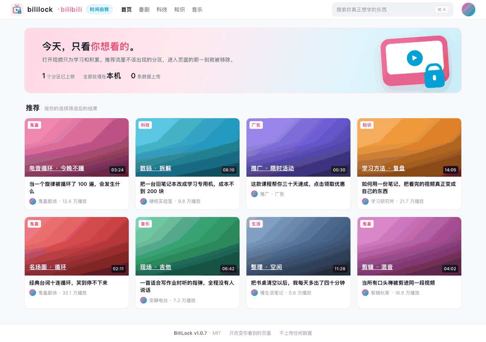
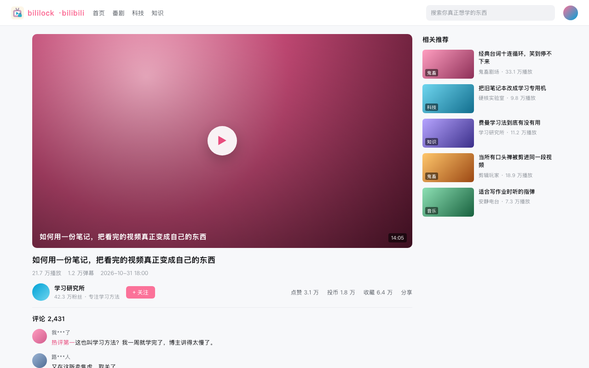
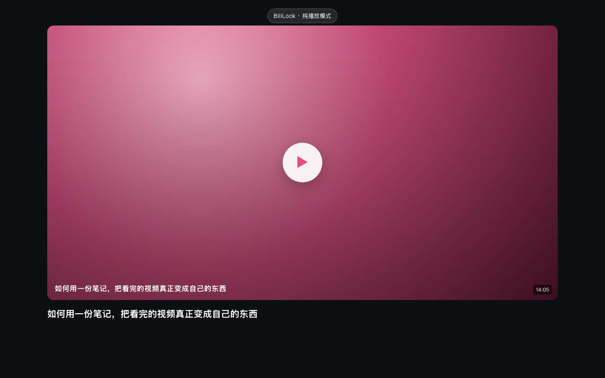
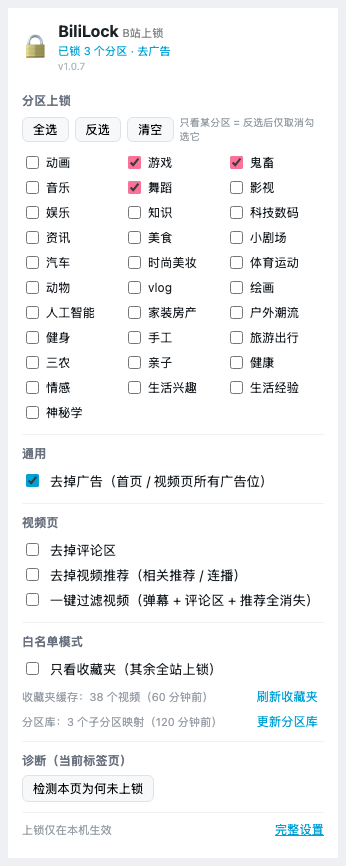

<p align="center">
  
</p>

<h1 align="center">BiliLock · B 站上锁</h1>

<p align="center"><strong>打开视频只为学习和目标，你有权把时间掌握在自己手中。</strong></p>

<p align="center">
  
  
  
</p>

这是一个简单的 B 站网页端浏览器拓展插件。

我打开 B 站，通常是为了查一个教程、看一节课，或者把某个操作流程跟着做一遍。但首页总会把我带到别的地方：一个接一个的推荐，半小时过去，想学的东西还没开始。

每次点开视频，看到神人遍地的评论区就气到红温，干脆眼不见为净。

不喜欢某个分区的视频，明明点了不感兴趣还一直推送，那就直接移除。

或者我上 b 站只是为了学习我收藏夹里的东西，那么我就只能看收藏夹里的东西，其他功能我不用，我也没必要用，就全部消失吧。

BiliLock 解决的就是这一件事。它不替你安排时间，只是把你不想要的那部分内容从页面上拿掉。举个例子，你勾选「鬼畜」，首页、搜索、相关推荐和收藏夹里来自鬼畜区的卡片就不再出现；你想专心看收藏夹，站内其他页面会显示一把锁。



BiliLock 过滤演示

### 一键视频页过滤前后对比

[](https://app.notion.com/p/README-c1e9c8216003827abcd701f7ed1e80d8?source=copy_link#4109c821600380e1be5be815f6ea870a)
[](https://app.notion.com/p/README-c1e9c8216003827abcd701f7ed1e80d8?source=copy_link#4109c821600380deacb3db4345b7c844)

一键视频页过滤前后对比

## 它做了什么 

给你的 b 站网页端做视觉上减法

- **分区上锁**：首页、搜索、相关推荐、收藏夹里，来自被锁分区的视频推送卡片直接隐藏消失。分区频道页和该分区的视频页会替换成一页上锁提示。
- **只看收藏夹**：开启后，收藏夹之外的 B 站页面全部上锁。收藏夹里仍然按你锁定的分区过滤。
- **去广告**：信息流广告、横幅、右下角弹窗，在接口层和 DOM 层一起隐藏。
- **视频页减负**：评论区、相关推荐、连播可以单独关掉；也可以一键只留播放器。
- **子分区**：不只认 31 个主分区，233 个子分区会按运行时分区库归到主分区。分区库从官方榜单自动收割，可在弹窗里手动更新。



## 原理

B 站把网页和推荐内容发到你的浏览器，浏览器把它渲染成页面。BiliLock 只在最后一步动手：从已经到达你电脑的内容里，挑出你不想看的元素，然后移除。

```
B 站服务器  →  返回网页 / 推荐流  →  你的浏览器  →  BiliLock 筛选  →  你看到的页面
                                                   ↑
                                          只在这里发生，且只在这台电脑上
```

DOM 与 CSS 过滤是主手段。首页推荐流还会在渲染前丢掉同一条目，避免卡片先闪一下再消失。除此之外，没有别的动作。

这是很普通的技术，因为它的本质就是一个浏览器拓展插件，任何人手动打开开发者工具摁一下 f12 就能做到，能注入样式或脚本的浏览器也是同样的都能做到的事，Chrome、Edge、Firefox、Safari 都可以兼容。它不针对 B 站的任何漏洞。它不替你做价值判断，只按你勾选的分区执行。

## 安装

1. 下载并解压 [bililock-v1.0.7-bundle.zip](https://github.com/Warpshlczy/bili-lock/releases/download/v1.0.7/bililock-v1.0.7-bundle.zip) 到一个全新的空目录。
2. 打开 `chrome://extensions`，开启右上角的「开发者模式」，点「加载已解压的扩展程序」，选择解压出的 `bililock-v1.0.7-bundle` 目录。
3. 在工具栏打开 BiliLock，勾选你不想看的分区。打开 B 站，设置立即生效。

Firefox 128+ 可在 `about:debugging#/runtime/this-firefox` 里临时载入同一个目录的 `manifest.json`。Edge 与 Chrome 步骤一致。

升级后如果觉得「没生效」，先在 `chrome://extensions` 点一次刷新，再对已打开的 B 站页面按 `Cmd+Shift+R` 强刷。弹窗底部的「检测本页为何未上锁」会直接告诉你卡在哪一步。

## 常见问题

**会影响我的推荐吗？**
不会。推荐仍然由 B 站计算，扩展只在你的屏幕上隐藏特定前端元素。

**会不会被风控？**
首屏里分区未知的卡片会先隐藏，再逐个确认。反查最多 3 个并发，间隔 120ms，遇到风控码会冷却 30 秒并退避重试。它不会在后台刷接口。

**收藏夹里的视频也会过滤吗？**
会。收藏夹条目和普通推荐卡片走同一套分区判断。

**关掉扩展能恢复吗？**
能。停用扩展或清空勾选，刷新页面即可，B 站本身没有任何改动。

## 开发与测试

```bash
bash tools/syntax_check.sh          # 语法检查，不依赖 Node

python3 -m http.server 8765
# 单元与集成测试：http://127.0.0.1:8765/tests/runner.html
# 模拟站点：      http://127.0.0.1:8765/tests/mock-site/index.html

python3 tools/build.py              # 生成 dist/bililock-v1.0.7-bundle.zip
```

## 隐私

扩展只申请 `storage`、`cookies`（读取你自己的 `DedeUserID`，用于收藏夹）和 bilibili 域权限。所有配置、分区缓存、收藏夹缓存都留在本机。没有账号系统，没有统计上报，没有远程配置。

## 说明

BiliLock 是个人效率工具，与哔哩哔哩官方没有关系。请遵守你所在地区的法律与 B 站用户协议，合理使用。

本项目没有改 B 站的接口设计。请求地址、参数、签名都保持原样，扩展不伪造任何请求。没有碰推荐算法。服务器该怎么算还怎么算，只是看不到其中一部分。换一台设备、换一个浏览器，推荐仍然是原来的推荐。没有逆向客户端，也没有破解风控。分区信息来自页面自身公开的数据和官方接口，不涉及加密协议或私有算法。没有绕过登录、会员或付费内容。扩展不提供任何观看权限。没有改变 B 站的运营模式。它不写入 B 站的数据，不影响其他用户，也不给 B 站增加或减少一个播放量。这个项目不赚钱。

如果你在 B 站工作，或者维护推荐系统：这个扩展对你的服务端没有任何写入，它只是用户本机浏览器前端上的一层显示选择。

如果它有用，点个 Star 就够了。

## License

MIT，仅供学习与个人使用。
